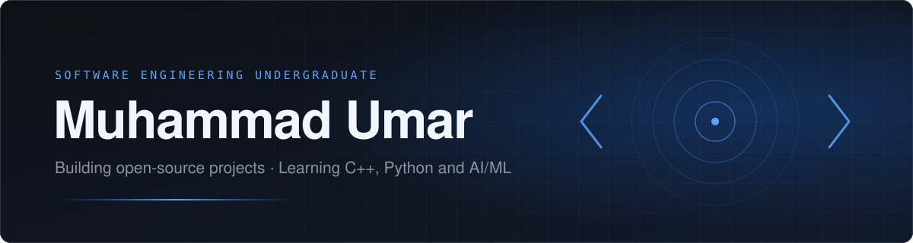
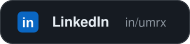
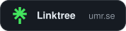
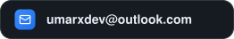
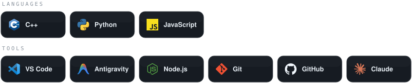
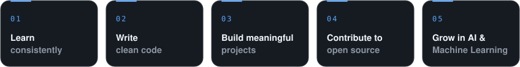
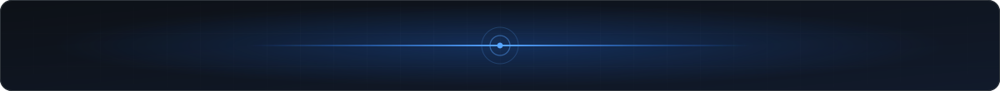

<picture>
  <source media="(prefers-color-scheme: dark)" srcset="assets/banner-dark.svg">
  <source media="(prefers-color-scheme: light)" srcset="assets/banner-light.svg">
  
</picture>

 

 

 

## About

Hi, I'm **Muhammad Umar**, a Software Engineering undergraduate building a strong foundation in **C++** and **Python**, with hands-on practice in **Object-Oriented Programming**, **Data Structures & Algorithms**, and core software engineering principles. I'm early in the journey, and I learn best by building: small open-source tools that solve real problems, released for anyone to use.

My goal is to become a software engineer who builds practical software and intelligent systems that solve real-world problems. I have a growing interest in **Artificial Intelligence** and **Machine Learning**, and I'm looking for internship and research opportunities where I can learn from experienced engineers and contribute.

 

## Where I Am Right Now

| | |
|:--|:--|
| **C++** | Studied the fundamentals and OOP. Comfortable with the basics, working toward intermediate. |
| **Python** | Basics. My entry point into AI and ML projects. |
| **AI and ML** | Growing interest. Learning the fundamentals so I can build small, working things. |
| **Open source** | Building browser extensions and tools, with AI-assisted development (Claude, Antigravity). |

 

## Tech Stack

  

 

## Building in Open Source

I like shipping small, useful tools in the open. Each project goes public here as it is ready.

<table>
  <tr>
    <td>
      <h3><a href="https://github.com/umr-x/ImgFetch">ImgFetch</a></h3>
      
A free image downloader for Chrome and Edge. Save images in the best available quality, scan a whole page at once, and capture screenshots. No accounts and no tracking.

      

        
        
      

    </td>
  </tr>
</table>

More projects coming soon.

 

## Currently

- Strengthening C++ fundamentals and OOP
- Learning Python basics, aiming at small ML projects
- Building and releasing the next open-source project

 

## GitHub Statistics

 

## Mission

  

 

**Thanks for visiting my profile.** 
If you find my work interesting, consider following my GitHub journey.

 

<picture>
  <source media="(prefers-color-scheme: dark)" srcset="assets/footer-dark.svg">
  <source media="(prefers-color-scheme: light)" srcset="assets/footer-light.svg">
  
</picture>

Curiosity brought me to software engineering. Every project is practice at building technology that solves a real problem.

